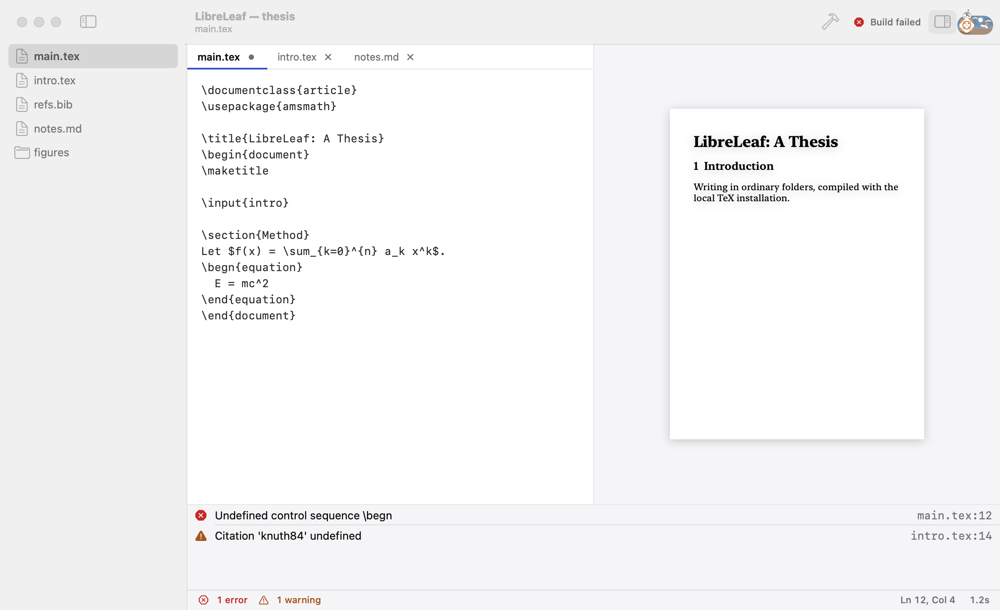
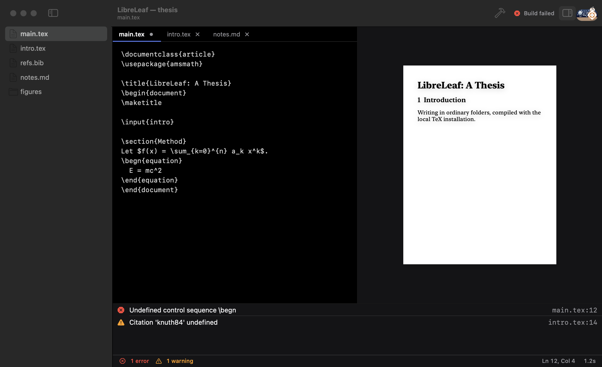
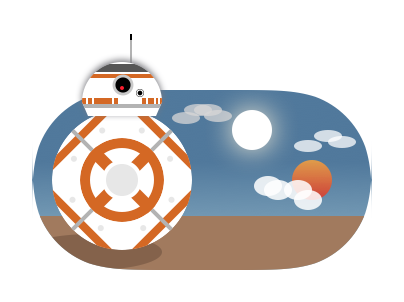
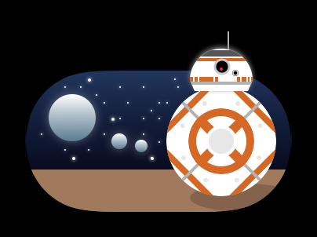

# NativeLatexDesign

SwiftUI design system for the LibreLeaf Mac app (code paths keep the `NativeLatex` name). macOS 14+, Swift 6, no dependencies.

Sources of the look: the Internship tracker (`~/Downloads/Internship/frontend/src/style.css`: white/black, hairlines, pill controls, one blue) and the website's BB-8 switch (`~/Downloads/Website/src/components/pro/opt4/bb8.css`). Rules come from `docs/workspaces/ux/ux-plan.md` → *Appearance and BB-8 control*.

| Light | Dark |
| --- | --- |
|  |  |
|  |  |

## Integrate

Add `NativeLatex/Design` as a local package (Xcode → File → Add Package Dependencies → Add Local…), link `NativeLatexDesign`, then:

```swift
import NativeLatexDesign

@main
struct LibreLeafApp: App {
    var body: some Scene {
        WindowGroup {
            WorkspaceShell(
                title: workspace.name, subtitle: workspace.rootFileName,
                buildState: build.state,                      // .idle .building .succeeded .failed .stale
                status: ShellStatus(errors: e, warnings: w, line: ln, column: col, lastBuild: .milliseconds(ms)),
                showPreview: $layout.showPreview, showPanel: $layout.showProblems,
                onBuild: build.run                            // toolbar Build, ⌘B
            ) {
                FileTree()                                    // sidebar (hideable, standard sidebar toggle)
            } editor: {
                VStack(spacing: 0) {
                    SourceTabBar(tabs: tabs, selection: $activeTab, onClose: close)
                    SourceTextView()                          // your NSTextView wrapper; use Theme.editorFont
                }
            } preview: {
                PDFPreview()                                  // PDFKit; keep real page colors
            } panel: {
                ProblemList(problems: problems) { reveal($0) } // sorted by severity, file, line
            }
        }
        .commands { AppearanceCommands() }                    // View > Appearance: System / Light / Dark
        Settings { AppearanceSettingsView() }                 // Settings > Appearance
    }
}
```

The shell already puts `BB8Toggle()` in the trailing toolbar. Use it alone elsewhere with `BB8Toggle(em: 4)`.

## API

| Symbol | Purpose |
| --- | --- |
| `AppearanceStore.shared` | `mode: AppAppearance` (`.system` default, `.light`, `.dark`), persisted in `UserDefaults` key `appearanceMode`. Sets `NSApp.appearance`, so all windows, sheets and menus change together. `.system` sets it to `nil`, so macOS changes flow through live. `toggle(currentIsDark:)` picks the opposite of the effective appearance as an override. |
| `AppearanceSettingsView`, `AppearanceCommands` | Settings radio group; View menu picker with checkmarks. |
| `BB8Toggle(store:em:)` | Day/night switch. Shows the effective appearance and stays in sync across windows through `colorScheme`. Tab-focusable with an accent focus ring; Space toggles. VoiceOver: "Dark appearance, On/Off", hint "Use System is in Settings". Tooltip: "Switch to Light/Dark Appearance". Reduce Motion: the scene changes with no animation. Pressing tilts the head ±25°, as `:active` does in the CSS. |
| `BB8Artwork(night:pressed:em:)` | Stateless art for previews and tests. |
| `Theme` | Dynamic colors (`background`, `surface`, `foreground`, `secondary`, `line`, `accent`, `accentText`, `onAccent`, `error`, `warning`, `success`), spacing `s1…s6` (4–32), `controlHeight`, `editorFont`, `titleFont`, `captionFont`. Each color resolves per window appearance, with Increase Contrast variants. |
| `View.libreLeafTheme()` | Root modifier: accent tint, foreground, background. |
| `PillButtonStyle(prominent:)` | Capsule button: hairline outline, or filled royal blue. |
| `WorkspaceShell` | Toolbar (sidebar · title/root · Build · status · preview · BB-8), sidebar, editor/preview `HSplitView`, resizable problems panel, status bar. Under 760 pt wide, the preview toggle swaps the preview in for the editor instead of squeezing two columns. |
| `BuildStatusBadge`, `StatusBar`, `SourceTabBar`, `ProblemList` | Usable on their own. State always appears as symbol plus text, never color alone. |

### Colors

| Token | Light | Dark |
| --- | --- | --- |
| background | `#FFFFFF` | `#000000` |
| surface | `#F5F5F7` | `#141416` |
| foreground | `#0A0A0A` | `#F5F5F7` |
| secondary | `#6E6E73` | `#98989D` |
| accent (fill, white text) | `#2F55D4` (6.2:1) | `#4169E1` royal blue (4.9:1) |
| accentText | `#2F55D4` | `#7E9BFF` (8:1 on black) |

The app sets its own accent with `.tint`, so a system accent override doesn't change the brand. BB-8 keeps its original orange and desert colors.

## Check

```sh
cd NativeLatex/Design
export DEVELOPER_DIR=/Applications/Xcode.app/Contents/Developer
swift test                                                  # 4 XCTest cases
swift run NativeLatexDesignDemo                             # LibreLeaf sample window
swift run NativeLatexDesignDemo --snapshot "$PWD/Screenshots"  # regenerate the PNGs above
```

Tests cover: the store starts on Use System and leaves `NSApp.appearance` nil; toggle overrides persist and Use System clears them; every token keeps 4.5:1 contrast in light, dark and both high-contrast appearances, including white on accent; the BB-8 day and night renders differ.

Still to check by hand in the real app: VoiceOver reading, Full Keyboard Access, Reduce Motion, and switching macOS appearance while two windows are open.
