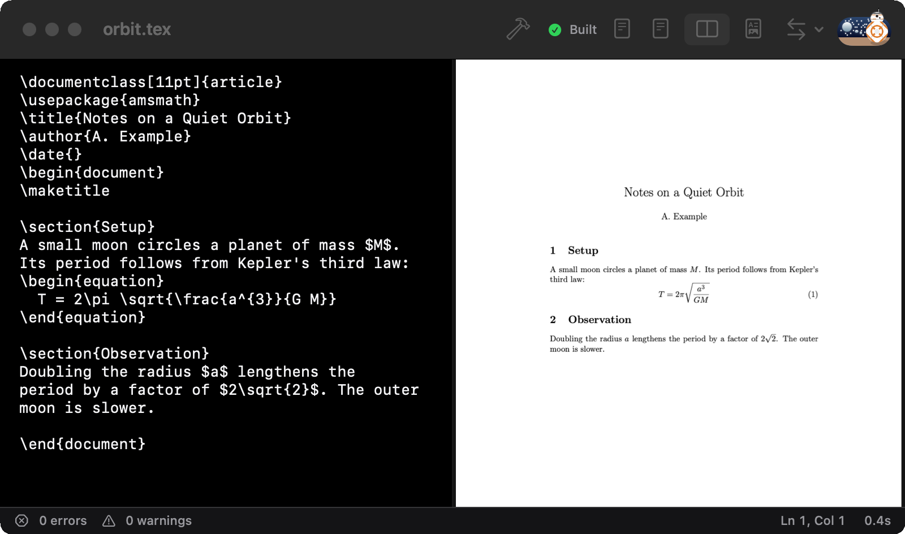
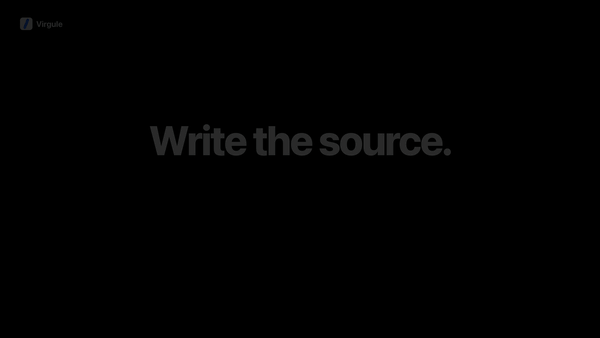
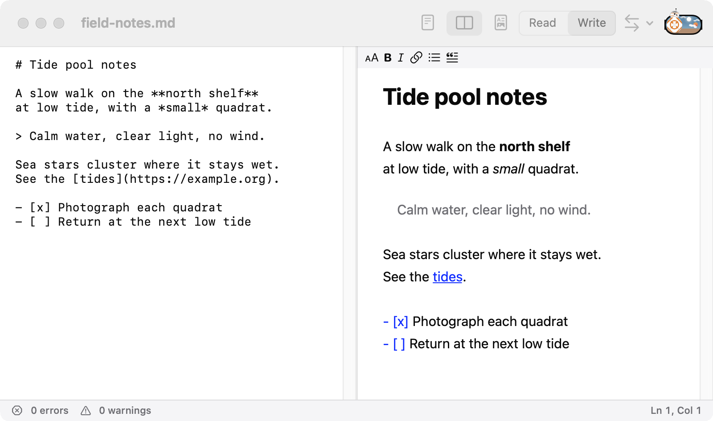
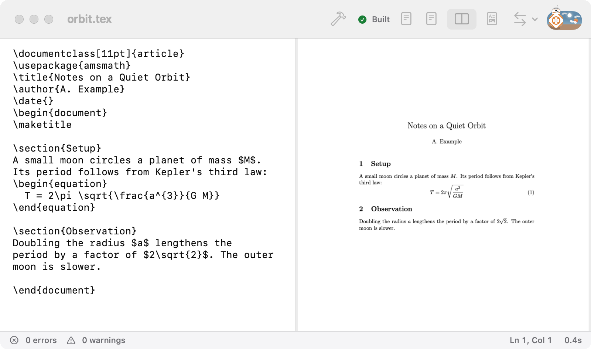

<p align="center">
  
</p>

<h1 align="center">Virgule</h1>

<p align="center"><b>Write the source. See the page.</b><br>
A native Mac editor for LaTeX, Markdown and plain text that keeps the rendered page beside your words.</p>

<p align="center">
  
</p>

<p align="center">
  <a href="landing/media/libreweave-demo.mp4"></a><br>
  <a href="landing/media/libreweave-demo.mp4"><b>▶ Watch the 18-second demo with sound</b></a> · <a href="https://virgule.ayushmadhav.com/">virgule.ayushmadhav.com</a>
</p>

## Markdown you can write and read

**Write** (<kbd>⌥⌘E</kbd>) is a full-width editor. Headings, emphasis, links, lists, quotes, code blocks and tables look formatted as you type, and the file underneath stays plain Markdown, character for character. **Read** puts the full rendering beside the source: tables, footnotes, task lists and TeX math as native MathML, rendered by the [Pandoc](https://pandoc.org) on your Mac with JavaScript off and no network access. **Document Mode** in the toolbar of every Markdown window switches between them. Write takes the whole window, and Read shows the rendered preview again.

<p align="center"></p>

## LaTeX, built on your Mac

Press <kbd>⌘B</kbd> and Virgule builds with the TeX already installed on your Mac: `latexmk` when you have it, otherwise one pass of `pdflatex`, `xelatex` or `lualatex`. The PDF opens beside the source. Errors show up in a Problems list that jumps to the line, and the full log is one click away. If a build fails, the last good PDF stays on screen, and the toolbar says it is out of date.

<p align="center"></p>

## Your files stay yours

- **Ordinary files, where they already live.** Open `.tex`, `.md`, `.bib` and plain text files from Finder or File ▸ Open. There is no library to import into and no project format.
- **Nothing leaves the Mac.** You don't need an account or a connection to edit, preview or build. Build output goes in a hidden `.libreleaf-build` folder next to your file.
- **Careful with your work.** If another app changes a file while you have unsaved edits, Virgule asks before reloading. It won't build over a file that changed on disk.
- **Copies, never conversions in place.** File ▸ Export Copy writes Word, OpenDocument, HTML or PDF. File ▸ Import Copy brings Word, OpenDocument, Markdown or LaTeX in as a new LaTeX or Markdown file. Both use your local Pandoc or LibreOffice.

## Made for the Mac

Each document gets its own window, with the menus, find bar and undo you'd expect.

- **Your layout.** Show the source, the preview, or both side by side (<kbd>⌥⌘1</kbd> <kbd>⌥⌘2</kbd> <kbd>⌥⌘3</kbd>). <kbd>⌥⌘P</kbd> toggles the preview. Narrow windows give one pane the full width.
- **One set of Markdown formatting commands.** The Format menu and the format bar share them: bold <kbd>⌘B</kbd>, italic <kbd>⌘I</kbd>, strikethrough <kbd>⇧⌘X</kbd>, link <kbd>⌘K</kbd>, headings <kbd>⌃⌘1</kbd>–<kbd>⌃⌘3</kbd>, lists, checklists, quotes and code blocks. They work in the source and in Write. In LaTeX windows, <kbd>⌘B</kbd> is Build.
- **Text left as you typed it.** Smart quotes, dashes and autocorrect are off in the source editor.
- **Light and dark.** Virgule follows the system, and the BB-8 switch in the toolbar sets Light or Dark for Virgule alone. Choose Use System in Settings or View ▸ Appearance to follow macOS again.

## Build it locally

| Requirement | |
| --- | --- |
| macOS 14 or later | Apple silicon tested |
| Xcode 26 or later | to build (tested with 27.2) |
| [MacTeX](https://www.tug.org/mactex/) or Homebrew `texlive` | LaTeX builds |
| [Pandoc](https://pandoc.org/installing.html) (`brew install pandoc`) | Markdown Read view, Export/Import Copy. LibreOffice is optional, for some office formats |

```sh
git clone https://github.com/ayushmk7/NativeLatex.git
cd NativeLatex
xcodebuild -project NativeLatex.xcodeproj -scheme LibreWeave -configuration Release \
  -derivedDataPath build build
open build/Build/Products/Release/Virgule.app
```

The Xcode scheme is still called `LibreWeave`; it builds `Virgule.app`. Copy `Virgule.app` into `/Applications` to keep it. Virgule then appears under **Open With** for `.tex` and `.md` files. Whether it becomes the default app is up to you.

## Under the hood

- SwiftUI document windows, an AppKit `NSTextView` source editor and a PDFKit preview. The only web view is the sandboxed Markdown preview, and the app starts no server.
- TeX builds run `latexmk -no-shell-escape` against tools found in `/Library/TeX/texbin`, `/opt/homebrew/bin` or `/usr/local/bin`. The output folder belongs to this install, and Virgule refuses to build into one that contains links or special files.
- The Markdown preview runs Pandoc with `--sandbox`, shows raw HTML and TeX as text, and caps input, render time, memory and output size. Past a cap, it stops the preview and editing carries on.
- The repository and Xcode project are named **NativeLatex** and the scheme **LibreWeave**; the app is **Virgule**. Design tokens live in the `NativeLatex/Design` package and converters in `NativeLatex/Integrations`, both local Swift packages with their own tests.

Status, plans and verified details: [docs/status.md](docs/status.md).
