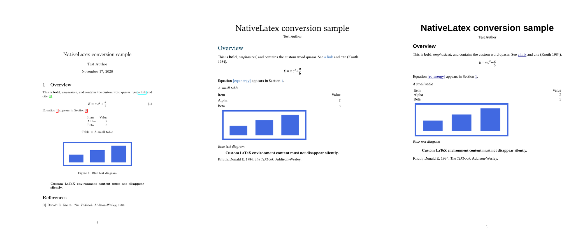

# DOCX and ODT conversion test · 2026-11-17

## What I ran

I created a small [LaTeX article](conversion-fixtures/article.tex) with a BibTeX citation, equation and cross-reference, table, image, link, custom macro, and custom environment, plus a [Markdown note](conversion-fixtures/notes.md) with inline math, table, image, footnote, and Swift code fence. The blue [figure](conversion-fixtures/figure.png) is a local test asset. The LaTeX source compiled with `latexmk` to a one-page PDF.

Pandoc 3.13 exported each source to DOCX and ODT. For the article I used `--standalone --citeproc --bibliography=refs.bib`; Markdown used Pandoc's default reader/writers. I read each office file back with Pandoc as Markdown, and imported the article files back to standalone LaTeX with extracted media. Both imported LaTeX copies compiled with `latexmk`, with undefined-reference warnings. LibreOffice 26.8.3 opened each DOCX/ODT and exported a PDF; I visually compared the first pages with the original TeX PDF. Word itself was not installed.

The comparison image shows the original TeX PDF at left, the DOCX opened in LibreOffice at center, and the ODT opened in LibreOffice at right. It is evidence for this fixture, not a promise of Word rendering or arbitrary-document fidelity.

## Observations

| Feature | DOCX export and import | ODT export and import |
| --- | --- | --- |
| Title, author, headings, emphasis, link, table, image, and bibliography text | Present and readable in LibreOffice | Present and readable in LibreOffice |
| Equation | Formula renders; original `(1)` number is gone | Formula renders; original `(1)` number is gone |
| Equation reference | Visible literal `[eq:energy]`; imported TeX has an undefined target | Same visible literal and undefined target |
| Citation | Original numeric `[1]` became `(Knuth 1984)` because the Pandoc default citation style differs | Same style change |
| Figure/table structure | Captions remain, but original numbering and TeX placement change | Captions become ordinary nearby text; numbering and placement change |
| Custom macro/environment | `\projectword` became plain `quasar`; custom environment text survived as a bold quote, without the original environment semantics | Same semantic flattening |
| Imported LaTeX | Compiles to PDF; original macros, `.bib` link, numbered equation and source labels are not reconstructed | Compiles to PDF with the same losses; title metadata is flattened to body text |

The temporary LaTeX imports referred to extracted images by absolute `/tmp` paths because the test extracted media there. A shipped import must place images inside the new workspace and rewrite links to relative paths before offering the copy; otherwise it breaks after temporary files are cleaned.

The Markdown note retained visible headings, emphasis, link, math, table, image, footnote, and code text in both LibreOffice-rendered formats. Pandoc's DOCX/ODT readback turned the fenced `swift` block into indented code without its language tag. ODT readback also represented inline math as display math, although LibreOffice rendered it inline. Treat readback structure as separate from what the office viewer displays.

Pandoc emitted no conversion warning for the lost equation reference or changed citation style. A successful process exit therefore cannot be the app's fidelity report. The app must keep the source, create a copy, and flag at least cross-references, citations, custom macros/environments, captions, and code-language metadata for review. A simple export is useful; claiming editable round-trip parity is not justified by this test.

## Automated follow-up

The `NativeLatex/Integrations` package tests now read these fixtures directly and repeat the round trips: LaTeX and Markdown through DOCX and ODT, Markdown to LaTeX with the image copied next to the new file, and LibreOffice DOCX↔ODT and PDF export. They also check that existing copies are never overwritten and that arguments are not run through a shell. The converter fixes the `/tmp` image-path problem above by extracting media to `<name>_media/` beside the copy with relative links, and it attaches the review notes listed in the [integration plan](../workspaces/integrations/integrations.md#fidelity-notes-the-converter-reports). These tests prove behavior with this fixture on this Mac's Pandoc 3.13 and LibreOffice only; Word was still not tested.

## Release gate

Before exposing DOCX/ODT as a reliable import/export action, repeat this test with a multi-file thesis, nested images, several citation styles, footnotes, complex tables, Unicode, and user-authored Word/LibreOffice files. Check the resulting document in Word as well as LibreOffice. For the first release, PDF export is the faithful LaTeX output; DOCX/ODT are explicitly reviewable copies.
